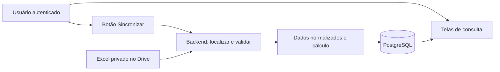

# Arquitetura proposta

Estado: desenho com base funcional de acesso implementada; nenhum serviço hospedado provisionado. Referências oficiais consultadas em 27/09/2026; limites devem ser reconfirmados antes do deploy.

## Aplicação única

Next.js com TypeScript e runtime Node no backend. Módulos internos de autenticação, consultas, sincronização, adaptador Drive/XLSX, regras por temporada e persistência PostgreSQL. Sem microsserviços, fila externa, agente ou LLM. No MVP, sincronização executada no ciclo da requisição autenticada, com orçamento de tempo e transação curta apenas para publicação.

Leituras usam conexão de papel somente SELECT; sincronização usa papel restrito a tabelas de ingestão/histórico/projeções. Migrações têm credencial separada, indisponível no runtime. O botão autoriza apenas leitura da fonte configurada no servidor, não dados arbitrários enviados pelo navegador.

## Comparação dos bancos gratuitos

| Critério | Supabase Free | Neon Free |
| --- | --- | --- |
| Banco | 500 MB por projeto | 0,5 GB por projeto |
| Computação | CPU compartilhada, 500 MB de RAM | 100 CU-h/mês por projeto, até 2 CU/8 GB |
| Arquivos | 1 GB de Storage | Página atual inclui 5 GB de Object Storage |
| Inatividade | Pausa após uma semana; prever retomada administrativa | Scale-to-zero após 5 minutos; reativa em consulta, com possível latência inicial |
| Conexões | Supavisor em modo transação para serverless; limite depende do compute | PgBouncer com até 10.000 clientes; conexões diretas continuam limitadas pelo compute |
| Autenticação | Supabase Auth, 50 mil MAU incluídos | Managed Better Auth; página atual indica até 60 mil MAU |
| Backup/restauração | Free não inclui backup automático nem PITR | Histórico de restauração limitado a até 6 h ou 1 GB de mudanças; não equivale a backup independente |
| Operação | Banco/Auth/RLS em um projeto; gerenciar pausa e exportações | Adequado a uso intermitente; gerir quota de computação e integração de autenticação |

Fontes: [Supabase Pricing](https://supabase.com/pricing), [conexões Supabase](https://supabase.com/docs/guides/database/connecting-to-postgres), [Neon Pricing](https://neon.com/pricing), [pooling Neon](https://neon.com/docs/connect/connection-pooling), [histórico Neon](https://neon.com/docs/introduction/history-window), [scale-to-zero Neon](https://neon.com/docs/introduction/scale-to-zero). As páginas do Neon foram lidas diretamente por HTTP quando o leitor web recusou o formato Markdown. Não assumir que Neon precisa de um provedor de autenticação externo: a oferta atual inclui autenticação.

**Recomendação para revisão:** Supabase Free pela integração de autenticação e controles de acesso, mantendo SQL portátil. Neon Free é alternativa se a retomada automática após inatividade for mais importante. Não criar tráfego artificial para evitar pausa nem habilitar upgrade automático. Não confundir armazenamento de objetos com capacidade do banco.

## Hospedagem e agendamento

Recomendar Vercel Hobby para o Next.js pessoal e não comercial. A documentação atual informa limite de duração de função Hobby de 300 s; configurar orçamento interno menor e medir antes da implantação. Se o trabalho crescer além disso, interromper com segurança e planejar processamento em lotes; não disparar tarefas soltas após responder HTTP. [Hobby](https://vercel.com/docs/plans/hobby).

Não configurar cron no MVP. Para etapa futura, Hobby permite no máximo execução diária por cron, com precisão dentro da hora, não horário exato. Não atende atualização de poucos em poucos minutos. Manter o botão manual mesmo após agendamento. [Limites de cron](https://vercel.com/docs/cron-jobs/usage-and-pricing). Não criar alternativa de scheduler sem necessidade confirmada.

## Acesso pessoal e segredos

- Supabase Auth com login Google e um usuário previamente cadastrado, conforme preferência posterior do usuário; cadastro público desligado. Validar sessão no servidor e comparar UUID com OWNER_USER_ID em toda consulta e sincronização. Usar proteção em duas etapas da conta Google; MFA próprio do Supabase ainda não implementado.
- Respostas pessoais com cache privado/no-store, sem HTML estático público ou cache CDN compartilhado. Nenhum dado em logs de build ou previews públicos.
- Se tabelas forem expostas pela Data API, habilitar RLS e negar escrita ao cliente; preferir esquema privado para as tabelas do domínio, não exposto pela API. Papel SQL leitor sem INSERT/UPDATE/DELETE. Não depender apenas de ocultar botões.
- A sincronização exige POST, origem validada e proteção CSRF compatível com cookies seguros. Negar GET para operação manual. Limitar frequência e uma execução concorrente por fonte.
- Chaves SQL, conta de serviço Google e chave administrativa Supabase nunca têm prefixo NEXT_PUBLIC. Uma chave publicável não substitui autorização. O runtime proposto não precisa da service_role para consultar ou sincronizar.
- Segredos em gerenciador da hospedagem; `.env.local` somente local. Não registrar tokens, URLs assinadas, linhas completas ou mensagens brutas que contenham credenciais.
- Para o PostgreSQL, TLS e pool pequeno; separar URL de migração da URL pooled e configurar driver conforme o modo de pooling. Não confiar em variáveis de sessão persistentes entre transações.

Referência de controle: [RLS Supabase](https://supabase.com/docs/guides/database/postgres/row-level-security). Validar também negação pelo papel SQL, que não recebe automaticamente a sessão HTTP.

## Volume e custo: estimativas, não medições de produção

Avaliações: orçamento hipotético de 1.000 álbuns × 5 KB normalizados = aproximadamente 5 MB; reservar 20–50 MB para índices, revisões e proveniência incremental. Evitar duplicar toda a fonte em cada execução sem mudanças. O arquivo descoberto tem cerca de 50 KB, mas tamanho de XLSX comprimido não estima tamanho relacional.

Scrobbles: hipótese de 100/dia → 36.500/ano. A 0,5–1 KB por registro já com índices, aproximadamente 18–37 MB/ano; dez anos podem consumir 180–370 MB, além do domínio e overhead. Medir com `pg_total_relation_size` após amostra real. Não armazenar respostas JSON redundantes por padrão.

Proposta Last.fm: começar com últimos 90 dias (aproximadamente 4,5–9 MB nessa hipótese); expansão histórica depende de objetivo e medição. Não importar todo o histórico para depois decidir se é necessário. Alertar ao atingir 70% da quota, sem upgrade automático.

## Backup e recuperação

Free exige estratégia própria. A documentação Supabase recomenda exportações para projetos gratuitos. [Backups](https://supabase.com/docs/guides/platform/backups).

Na implementação: exportação lógica com ferramenta compatível com a versão do PostgreSQL, criptografada e guardada fora do Git e fora da pasta fonte read-only. Executar antes de migrações e semanalmente, mantendo quatro cópias semanais; essa rotina de backup não é agendamento de importação. O destino inicial é `.private/backups/`, escolhido para o ensaio local, com chave separada; ainda será necessária uma cópia fora deste computador. Documentar RPO de até sete dias para histórico que não seja recuperável da fonte e meta de RTO de um dia, não SLA garantido. Procedimento em [backup.md](backup.md).

Ensaiar restauração em banco isolado: aplicar roles/configuração necessárias, restaurar dados, verificar contagens, hashes de origem, notas originais, revisões e último snapshot. Configuração de Auth/segredos e objetos fora do banco exigem recuperação separada; dump do domínio não é backup completo do serviço. Não promover banco restaurado sem verificar usuário permitido. Fonte atual permite reimportar fatos, mas não substitui backup das versões históricas.

## Entrega técnica após revisão

Usar npm com lockfile versionado, versão LTS de Node fixada após verificar compatibilidade do Next.js e instalação reproduzível por `npm ci`. Versionar migrações SQL em sequência; nunca editar migração já aplicada. CI: lint, tipos, testes unitários, integração com PostgreSQL efêmero e build, sem credenciais reais em PRs. Fixtures apenas fictícias.

Scripts implementados: `lint`, `typecheck`, `test`, `test:integration`, `test:e2e`, `build`, `db:migrate`. Package.json, lockfile, duas migrações e CI estão presentes. Acesso, consulta do acervo, importação e publicação atômica foram implementados e exercitados localmente com serviços reais. Recuperação por backup e verificação dos cenários de falha permanecem pendentes. Ver [setup](setup.md).

## Temporadas e regras

A configuração por ano, os adaptadores de campeonato, as rotas com `temporada`, a migração aditiva e o procedimento de ativação de 2027 estão em [temporadas.md](temporadas.md). A página privada de regras independe de uma fonte importada.
