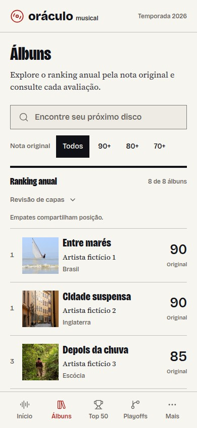
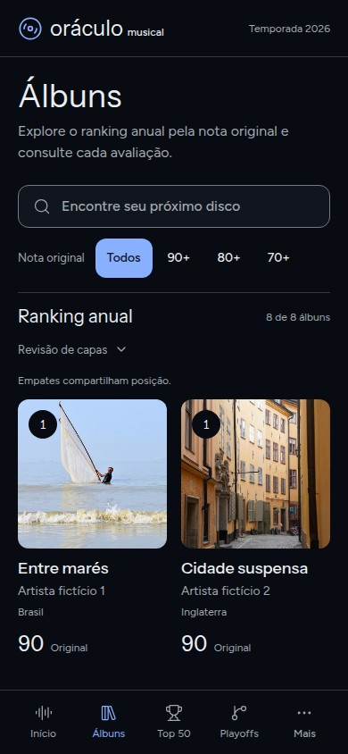

# Duas direções visuais para Álbuns

O usuário escolheu a direção **A, Revista musical**, com a possibilidade de
usar tema escuro. A implementação agora aplica A em `src/`, com Claro, Escuro
e Seguir o sistema. O escuro mantém o layout editorial e o vermelho de A;
não adota a grade e a identidade azul de B. Autenticação, banco e regras do
ranking são preservados. A skill Hallmark continua local e ignorada pelo Git.

As imagens abaixo registram as propostas originais, anteriores à implementação.
O sistema escolhido está em [design.md](../design.md).
As [capturas da implementação real, clara e escura](editorial-implementation.md)
substituem as propostas abaixo para revisar o resultado atual.

## Comparação no celular

| A. Revista musical | B. Discoteca escura |
| --- | --- |
|  |  |
| Favorece a comparação de posições e notas. | Favorece o reconhecimento pelas capas. |

Desktop: [Revista musical](previews/revista-desktop.jpg) e
[Discoteca escura](previews/discoteca-desktop.jpg).

As capturas acima vêm da [execução de prévias #3](https://github.com/mauricioforteneto/oraculo-musical/actions/runs/41054791423).
A revisão Hallmark independente retornou **ship**, sem defeitos objetivos de
legibilidade, contraste ou colisão nas quatro larguras. Busca, filtros, retorno,
vazio e primeiro álbum na primeira tela passaram. A aplicação também passou
build, lint, TypeScript, 213 testes unitários, 37 de integração, 15 de acesso e
seu teste de layout na [execução Verify #35](https://github.com/mauricioforteneto/oraculo-musical/actions/runs/41054791553).

A versão anterior mostrava as situações de capa diretamente. Nas propostas,
elas ficam dentro de “Revisão de capas”, liberando espaço para o ranking. Essa
troca deve ser considerada na escolha. Créditos em [previews/README.md](previews/README.md).

## A. Revista musical

Base Hallmark: Editorial, escolha 1/3 do sorteio editorial. Papel claro,
tinta escura, vermelho como sinal por solicitação do usuário, Bricolage Grotesque
condensada nos títulos e Source Serif 4 no texto. Regras e alinhamentos de uma
revista, sem cartões externos; capas e notas conduzem a leitura em linhas.

## B. Discoteca escura

Base Hallmark: Ribbon, escolha 2/3 do sorteio atmospheric, variante noturna.
Grafite azulado, texto claro, azul como sinal por solicitação do usuário,
Instrument Sans e Figtree. As capas aparecem em uma grade de três colunas no
desktop e duas no celular, com posição e nota junto de cada álbum. Ornamentação
de marketing do tema não é usada numa tela de aplicação.

## O que comparar

- Visibilidade do primeiro álbum na primeira tela do celular.
- Leitura de título, artista, posição e nota.
- Lista editorial versus navegação por capas.
- Conforto do tema claro e do tema escuro.

Busca, filtros por nota, revisão de capas recolhível, navegação até a avaliação e
retorno mantêm contexto em URL no cenário de demonstração. A navegação para
outras telas informa o limite desta prévia. Não há ações de escrita no acervo.

## Material demonstrativo

Os títulos, artistas e notas são explicitamente fictícios. Ambas as direções e
a referência atual usam exatamente os mesmos oito registros. As notas partem
dos valores sintéticos já usados nos testes; não representam o acervo do usuário.
Quatro fotografias licenciadas da biblioteca Hallmark substituem as capas, com
autoria, licença e link da origem em `photos.json` e no rodapé de cada proposta.
As imagens são recortadas em quadrado apenas por CSS e permanecem substituíveis
pelas capas reais. As fontes gratuitas são carregadas pelo Google Fonts com swap.

## Ver e reproduzir

O workflow **Design previews** instala Chromium e executa:

```sh
node tests/browser/design-preview-check.mjs
```

Ele verifica 360, 390, 768 e 1280 px, captura viewport e página inteira, compara
com o layout atual em 390 e 1280 px e guarda PNGs, cópias JPEG e `index.html` no artefato
`hallmark-duas-direcoes-<execução>` por sete dias. As prévias são também exportadas
em JPEG nos logs para que o conector as disponibilize nesta conversa, com menor
volume; os PNGs originais permanecem no artefato. Nenhum deploy é feito.

A direção A foi escolhida e está implementada nos componentes reais. A validação
do aplicativo usa `npm run build`, `npm run test:layout` nos dois temas e testes
de preferência com Playwright; as propostas A/B ficam como registro da decisão.
