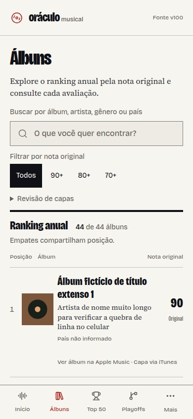
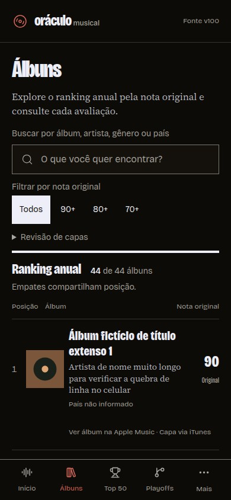

# Revista musical: implementação clara e escura

A direção A foi aplicada aos componentes reais. O modo escuro mantém a mesma
lista, fontes e vermelho. O seletor **Tema** oferece Claro, Escuro e Seguir o
sistema: na lateral do desktop, no menu **Mais** do celular e na entrada.
A escolha fica salva neste navegador e acompanha outras abas.

| Claro no celular | Escuro no celular |
| --- | --- |
|  |  |

Desktop: [claro](previews/editorial-claro-desktop.jpg) e
[escuro](previews/editorial-escuro-desktop.jpg).
[Seletor no menu do celular](previews/editorial-tema-mobile.jpg).

Estas são capturas diretas do Chromium, sem retoque, dos componentes reais com
dados explicitamente fictícios. O caso inclui nome longo, crédito de capa,
empates e capas ausentes. As capas pessoais continuam vindo das fontes existentes;
nenhuma capa demonstrativa foi acrescentada ao aplicativo.

## O que mudou

- Título do álbum ganha destaque, com artista na leitura serifada, capa maior
  e nota original em números tabulares. A lista preserva o ranking e os empates.
- Busca e notas ficam antes da lista. “Revisão de capas” usa disclosure nativo,
  aberto automaticamente quando um filtro de capa vem na URL.
- Bricolage Grotesque e Source Serif 4 são auto-hospedadas pelo build.
- Temas compartilham tokens semânticos. As demais telas recebem compatibilidade
  de cores e fontes; sua organização e regras permanecem as existentes.
- A preferência é aplicada antes do corpo. Sem escolha, segue o sistema, inclusive
  sem JavaScript. Se o armazenamento falhar, a página aplica o tema e avisa que
  a escolha não pôde ser salva.

## Verificação

[Verify #39](https://github.com/mauricioforteneto/oraculo-musical/actions/runs/41059605363),
commit `1b05fd4`, aprovou lint, TypeScript, `npm run build`, 213 testes unitários,
37 de integração, 19 de acesso/preferência e `npm run test:layout`.

O layout percorreu 11 telas × 4 larguras (360, 390, 768, 1280) × 2 temas.
Verificou ausência de overflow, fontes efetivamente carregadas, primeiro álbum
inteiro na primeira tela, rodapé livre da navegação, filtros e contexto de URL,
menu/teclado/foco e os fluxos existentes de sincronização e capas.
Os testes de preferência cobrem persistência, sistema, mudança entre abas,
armazenamento bloqueado e CSS sem JavaScript.

[Artefato com PNGs, JPEGs e trace](https://github.com/mauricioforteneto/oraculo-musical/actions/runs/41059605363/artifacts/12977833993).
Os JPEGs desta documentação vêm dessa execução. PNGs completos e trace ficam
disponíveis no artefato por sete dias.

Hallmark estático no catálogo/shell/seletor/tokens: 0 FAIL e 0 REFLEX.
As duas notas de medida foram justificadas: introdução curta de 42ch e aviso
sob o seletor de 32ch. O render tier do sloplint não rodou neste sandbox;
a revisão usou as capturas reais do CI. A revisão independente retornou
**ship**, sem achados visuais prioritários nas quatro larguras e nos dois temas.
Contrastes numéricos dos tokens: texto ≥ 4,5:1 e bordas de controles ≥ 3:1
nos dois modos, incluindo pares de seleção, aviso, sucesso e erro.

O [sistema visual](../design.md) registra as decisões atuais. A skill e os
relatórios locais continuam ignorados pelo Git. Não houve merge ou deploy.
